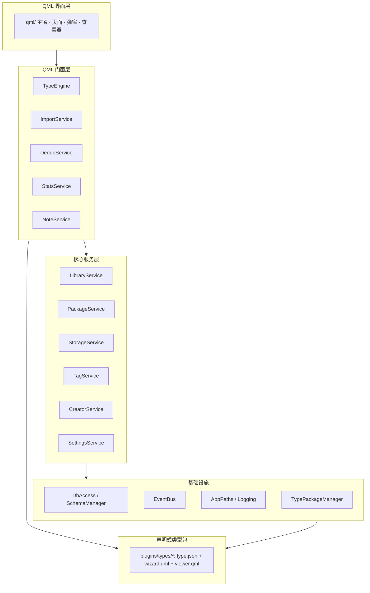

# Jarvis


本地个人收藏资源管理工具，用于统一管理画作、漫画、小说、电影、建模、摄影、剧集等数据包。

Jarvis 把「一堆散落在硬盘里的文件」整理成可检索、可标注、可统计的本地资源库。它不依赖云服务：每个资源库就是一对「SQLite 数据库 + 实体目录」，类型由声明式插件定义，新增资源类型不需要改动核心代码。

- 当前版本：`0.1.0`
- 主要面向 Windows 桌面，Qt 6 + QML 实现，采用绿色目录部署（无安装包）

## 功能特性

- **多库管理**：一个库一个进程一个窗口；支持建库、切换、重命名、删除、导入导出，以及按库启用类型。
- **双通道导入**：向导通道按类型逐项填写元数据；预处理通道扫描整个目录批量生成导入计划，再统一补填标题、创作者与日期。
- **整本小说切章**：导入 `.txt` 时自动探测编码（UTF-8 → GB18030 回退），按类型包声明的章节规则切分为章节文件与 `config.txt` 清单。
- **资源检索**：按类型、关键词（标题或创作者）、创作日期区间、入库日期区间、标签组合筛选，支持分页与瀑布流封面。
- **树状标签**：全库共享、与类型无关的多级标签；同一数据包的标签集合必须满足反链约束（不能同时选中祖先与后代），支持 JSON 导入导出。
- **创作者与别名**：正式名 + 多别名，导入时自动 find-or-create；空名统一归入系统保留创作者「佚名」。
- **浏览记忆与评分**：记录每个包的浏览位置；评分支持多次加权（默认新评占 60%），方便按「最近偏好」排序。
- **短笔记**：笔记元数据存库，正文以 Markdown 存在库外文件，保存时通过文件 mtime 检测外部改动，避免静默覆盖。
- **数据统计**：类型占比、创作者 Top10、创作月份趋势、标签计量四类图表，外加按日活跃热力图。
- **图片查重**：字节级 `content_hash` 判定完全重复，感知 `pHash` 判定近似重复；支持外部文件夹扫描与存量补指纹。
- **部署友好**：`cmake --install` 生成可直接拷走的目录，Qt 运行库、QML 模块与类型包一并收拢。

## 技术栈

| 项目 | 说明 |
| --- | --- |
| 语言 | C++17 |
| 框架 | Qt 6.5+（Core / Gui / Qml / Quick / Sql / Graphs / Core5Compat / Multimedia） |
| 构建 | CMake ≥ 3.21 |
| 数据库 | SQLite（一写多读双连接） |
| 界面 | QML（Qt Quick Controls），图表使用 Qt Graphs，视频播放使用 Qt Multimedia |
| 开发环境 | Qt 6.9.3 + MSVC2022 64bit（亦可用 MinGW 构建） |

## 快速开始

### 环境要求

1. Qt 6.5 或更高版本，且安装以下模块：Core、Gui、Qml、Quick、Sql、Graphs、Core5Compat、Multimedia。
2. CMake 3.21 或更高版本。
3. MSVC 2022 或 MinGW 64 位工具链（需与 Qt 套件匹配）。

### 构建

```bash
cmake -S . -B build -DCMAKE_PREFIX_PATH="C:/Qt/6.9.3/msvc2022_64"
cmake --build build --config Release
```

- MSVC 为多配置生成器，产物位于 `build/Release/jarvis.exe`；MinGW 为单配置，产物位于 `build/jarvis.exe`。
- Debug 构建会保留控制台窗口，便于直接观察 `qDebug` / `qWarning` 输出；其余配置不显示控制台。
- 构建完成后会把 `plugins/` 自动复制到可执行文件旁，形成 `<exe目录>/plugins/types/<form>/` 的部署结构。

### 运行

```powershell
jarvis.exe                    # 未指定库时：有上次的库则进入主窗口，否则打开库管理窗口
jarvis.exe --library 我的库    # 直接打开指定库（库名即 envs 下的目录名）
jarvis.exe --help             # 查看全部命令行选项
```

- 首次运行会在可执行文件旁自动创建 `envs/`。
- 日志位于 `envs/logs/`，按日滚动；可用环境变量 `JARVIS_LOG_LEVEL` 控制级别（`debug` / `info` / `warning` / `critical`，默认 `info`）。

### 部署

```bash
cmake --install build --prefix dist --config Release
```

`dist/` 即完整绿色目录：`jarvis.exe` + Qt 运行库 + 平台插件 + QML 模块 + `plugins/`。整套目录可直接拷贝到其他机器运行，`envs/` 在目标机器首次运行时生成。

## 使用流程

1. **建库**：启动后若没有库，会先打开库管理窗口；填写库名、实际库根路径，并勾选该库启用的资源类型。
2. **导入**：从顶栏的文件菜单选择类型与通道。向导通道适合少量、逐个填写；预处理通道适合整目录批量导入，扫描后可统一补填元数据。
3. **浏览**：资源页支持筛选与分页，点击封面打开查看器，右键或详情入口可修改标题、创作者、创作日期、评分与标签。
4. **整理**：在标签管理中维护标签树，在创作者管理中合并别名；标签支持整体导出与合并导入。
5. **记录**：笔记页可创建 Markdown 短笔记，与资源库同生命周期。
6. **统计**：统计页按需重算，批量导入期间不会反复聚合；可查看类型、创作者、月份分布与活跃热力图。
7. **查重**：查重窗口可扫描全库或指定类型，阈值 `0` 为精确重复、`1–16` 为 pHash 近似重复；也可附带外部文件夹一起比对。

## 目录结构

```text
Jarvis/
├── CMakeLists.txt            # 构建、部署与类型包拷贝
├── images.qrc                # 窗口图标资源清单
├── core/                     # 全部核心逻辑，编译为 jarvis_core 静态库
│   ├── main.cpp              # 唯一入口：日志 → 命令行 → 组装 → 拉起 QML
│   ├── app/                  # 组合根 Application
│   ├── common/               # 日志、媒体类型判定、错误与时间戳
│   ├── events/               # 事件总线
│   ├── library/              # 路径约定、库配置、数据库连接、库服务
│   ├── schema/               # 核心表结构与版本迁移
│   ├── types/                # 类型包解析/发现、类型引擎
│   ├── storage/              # 桶号、落位、封面生成、导入导出执行器
│   ├── import/               # 导入计划、预处理扫描、小说分析
│   ├── dedup/                # 内容指纹、扫描与补指纹工作线程
│   ├── package/              # 数据包查询、评分、浏览记忆、删除
│   ├── tag/                  # 标签树与绑定
│   ├── creator/              # 创作者与别名
│   ├── note/                 # Markdown 短笔记
│   ├── stats/                # 统计聚合
│   ├── settings/             # 全局设置
│   ├── text/                 # 整本 txt 解码与切章
│   └── ui/                   # 查看器上下文
├── qml/                      # 界面
│   ├── Main.qml              # 多进程入口（主窗口 / 库管理窗口）
│   ├── pages/                # 资源页、统计页、笔记页
│   ├── windows/              # 详情、查看器、库管理、查重窗口
│   ├── dialogs/              # 导入、设置、筛选、编辑、标签、创作者等弹窗
│   └── include/              # 顶栏、导航、标签树、图表卡片等组件
├── plugins/
│   ├── common/               # 类型包共用的 QML 组件（日期选择、媒体查看器等）
│   └── types/<form>/         # 7 个内置类型包
├── res/title/                # 窗口按钮与导航图标
└── envs/                     # 运行期生成（未纳入版本控制）
```

`build/`、`envs/`、`database/`、`tests/` 均为本地目录，未纳入版本控制。

## 架构设计



**组合根与依赖顺序**

`Application` 是全程序唯一创建并装配服务的地方，装配顺序为：路径与事件 → 类型包发现 → 库服务 → 创作者/标签 → 笔记 → 存储 → 包服务 → 查重 → 导入 → 统计 → 设置 → 类型引擎。

**QML 上下文对象**

界面不直接访问数据库与文件系统，全部通过以下 7 个上下文对象调用：

| 名称 | 类型 | 提供的能力 |
| --- | --- | --- |
| `libraryService` | LibraryService | 库列表、当前库、建库/切换/删除/重命名、导入导出库、拉起新进程、类型启用 |
| `typePackageManager` | TypePackageManager | 已加载类型包的 `form` / `displayName` / `version` |
| `typeEngine` | TypeEngine | 启用类型、包清单、分页查询、详情读写、标签与创作者门面、设置、查看器上下文 |
| `importService` | ImportService | 执行导入计划、预处理扫描、导入预览、小说分析、导出包 |
| `dedupService` | DedupService | 导入前预检、写指纹、查重扫描、补指纹、取消与会话清理 |
| `statsService` | StatsService | 基线快照、强制刷新、标签计量 |
| `noteService` | NoteService | 笔记列表、读取、新建、保存、删除 |

**事件总线**

跨模块只通过 `EventBus` 的 4 个信号协作，不互相直接调用：`librarySwitched`、`packageCreated`、`packageUpdated`、`packageDeleted`。

**核心纪律**

- 所有 DDL 集中在 `SchemaManager`，业务代码不散落建表语句。
- 类型包不直接写数据库、不直接操作实体文件系统。
- 导入是复制，绝不移动或删除源文件。
- 评分入口唯一，类型包不得直写分数。
- 写操作走事务；数据库失败时回滚并清理本次新建的包目录与封面。

## 类型插件开发

每种资源类型都是 `plugins/types/<form>/` 下的一个声明式包，核心在启动时扫描并校验，非法包会跳过并记录日志，不影响其他包。

```text
plugins/types/<form>/
├── type.json     # 类型契约（必填）
├── wizard.qml    # 导入向导界面（导入该类型时加载）
└── viewer.qml    # 查看器界面（打开该类型的包时加载）
```

### type.json 字段

| 字段 | 必填 | 说明 |
| --- | --- | --- |
| `form` | 是 | 类型标识，小写字母开头的安全标识符，须与目录名一致 |
| `displayName` | 是 | 界面显示名，如「画作」 |
| `version` | 是 | 类型包契约版本 |
| `coreMinVersion` | 是 | 依赖的最低核心版本 |
| `packageLayout.kind` | 是 | 包布局类型，决定导入与扫描行为 |
| `packageLayout.naming` | 否 | 包内文件命名方式：`%03d` 或 `original` |
| `packageLayout.chapterRules` | 否 | 整本文本的章节规则表，仅 `wholeBookText` 使用 |
| `media` | 视情况 | 接受的媒体类别：`["image"]` / `["video"]` / `["image","video"]` |
| `browseOrder` | 否 | 预览顺序声明，如 `sequence`、`single` |
| `stats` | 否 | 统计维度扩展声明，当前只解析不渲染 |

`media` 的缺省推导：`imageSequence` 视为 `["image"]`，`wholeBookText` 为空；`singleMedia` 与 `mediaSequence` 必须显式声明。

### 四种包布局

| kind | 包的含义 | 导入与扫描行为 | 内置类型 |
| --- | --- | --- | --- |
| `imageSequence` | 一组有序图片 | 子文件夹或根目录散图各成一个包；复制前做图片完全重复预检 | `draw`、`comic` |
| `wholeBookText` | 一整本纯文本 | 解码后按章节规则切分为章节文件，并生成 `config.txt` 清单 | `novel` |
| `singleMedia` | 恰好一个媒体文件 | 保留原文件名；扩展名须在 `media` 内；无图片时生成占位封面 | `film`、`modelfilm` |
| `mediaSequence` | 一组有序媒体 | 一层文件夹 = 一个包，根目录散文件各自成包 | `photo`、`episode` |

### 新增一种类型

1. 新建 `plugins/types/<form>/` 目录。
2. 编写 `type.json`，选择与内容形态匹配的 `packageLayout.kind`。
3. 编写 `wizard.qml` 与 `viewer.qml`；共用控件通过 `import "../../common"` 引用。
4. 重新构建（或手工把目录复制到产物旁的 `plugins/types/`）。
5. 在库管理中勾选该类型，使其对当前库启用。

整个过程不需要修改 C++ 代码。

### 查看器上下文

`viewer.qml` 加载时会注入一个上下文对象，类型包通过它访问数据：

- `packageId` / `title` / `typeForm`
- `files`：包内内容文件清单（相对路径、`file://` URL、大小、`media` 类别），按相对路径排序；`config.txt` 等清单文件不在其中
- `chapters` / `volumes`：由 `config.txt` 解析出的章节与卷（非文本包为空）
- `readText(relativePath)`：读取包内文本（UTF-8 优先、GB18030 兜底）
- `positionJson` / `savePosition()`：读写浏览记忆，位置结构由类型自定义

## 数据存储

运行期数据统一位于可执行文件旁的 `envs/`：

```text
envs/
├── config.json              # 库登记信息与当前库
├── settings.json            # 全局设置（不随库）
├── logs/                    # 按日滚动日志
└── <库名>/
    ├── library.db           # 该库的 SQLite 数据库
    ├── cover/<桶>/<id>.jpg  # 封面（核心统一生成，对角线 512px JPEG）
    └── note/<id>.md         # 短笔记正文
```

实体包目录位于库登记的实际库根下：`<实际库根>/<桶>/<包id>/`，桶号由 id 推导：

```text
bucket = floor((id - 1) / 5000) + 1
```

删除留下的空洞不回收，新增包始终落在对应桶内。

**数据库版本**：核心表版本记录在 `PRAGMA user_version`，只做向前升级：

| 版本 | 内容 |
| --- | --- |
| v1 | 基线（合并了早期 v1–v6 的迁移历史） |
| v2 | 查重扩展：图片内容/感知指纹、视频指纹预留表 |
| v3 | 短笔记扩展：笔记元数据表（正文不存库内） |

库版本高于程序内置版本时只告警，不会静默当作「已是最新」。

**正文与索引分离**：笔记正文的唯一真相是 `note/<id>.md` 文件，数据库只做索引；保存时先原子写文件，再更新元数据。

## 已知限制

- 查重目前只覆盖图片；视频指纹表已预留但未接入算法。
- 视频类型仅按扩展名判定，能否播放取决于系统与 FFmpeg 多媒体后端。
- 自动化测试目录未纳入版本控制，仓库内没有可直接运行的测试入口。
- 部署脚本面向 Windows（windeployqt），其他平台的部署流程未做验证。

## 开发约定

- 阅读代码时优先看头文件注释：每个类与公共函数都写明了职责、输入与输出。
- 新增核心表结构变更时，在 `SchemaManager::ensureCoreSchema` 中递增版本并追加迁移分支，不在业务代码里写 DDL。
- 类型包只做声明与界面，数据落位、查重、评分一律由核心服务执行。
- 服务对 QML 统一返回 `{ok: bool, message?: string, ...}`，不要抛异常或用裸布尔值。
- 设置项由服务内部 clamp 到合法范围，不依赖调用方预先校验。

## 许可证

本项目采用 [MIT 许可证](LICENSE)。

Copyright (c) 2026 Demkens
